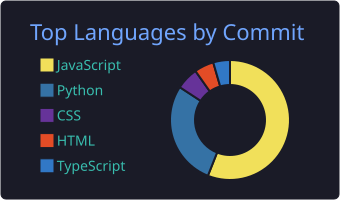
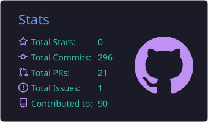
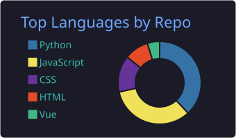
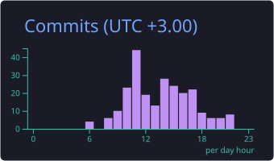

<!-- ═══════════════════════ ANIMATED HEADER ═══════════════════════ -->
<p align="center">
  
</p>

<p align="center">
  <a href="https://moringaschool.com/">
    
  </a>
</p>

<p align="center">
  
  
  
</p>

<!-- ═══════════════════════ TYPING ANIMATION ═══════════════════════ -->
<p align="center">
  <a href="https://github.com/Jeremiah-tech-dev">
    
  </a>
</p>

<p align="center">
  <a href="https://www.linkedin.com/in/jeremiah-koske-"></a>
  <a href="mailto:jeremiah.koske@student.moringaschool.com"></a>
  <a href="https://github.com/Jeremiah-tech-dev?tab=repositories"></a>
  
</p>

---

## ✨ About Me



I'm **Jeremiah**, a **Full-Stack Software Engineer** with **2+ years** of building and shipping production **web systems** and **Android & iOS apps**, with AI built in where it adds real value.

I like owning a product **end to end**: designing the backend, building the app, getting it through **Google Play & App Store** review, and keeping it healthy in production.

- 🌐 **Web systems:** scalable backends, REST APIs and fast React/Next.js frontends, including a platform serving **2,000+ users**
- 📱 **Android & iOS apps:** Flutter and React Native apps taken from code to **Google Play & App Store** release
- 🔐 **Security-first:** rotating JWTs, OTP recovery, **hardware-backed biometric auth**, multi-tenant data isolation
- 💳 **Payments:** **M-Pesa Daraja** and payment gateway integrations
- 🤖 **AI integration:** LLM agents with intent classification, LLM fallback & prompt-injection guardrails
- ⚡ **Performance:** **40%+** backend speed-ups through query & service optimisation

<br clear="right"/>

```python
from dataclasses import dataclass, field
from typing import Final


@dataclass(frozen=True)
class Engineer:
    name:     Final = "Jeremiah Koske"
    role:     Final = "Full-Stack Software Engineer"
    region:   Final = "Nairobi, Kenya 🇰🇪 · UTC+3"
    uptime:   Final = "2+ years shipping to production"

    expertise: dict = field(default_factory=lambda: {
        "architecture": ["system design", "distributed systems",
                         "event-driven services", "multi-tenant SaaS"],
        "backend":      ["API design", "async processing & workers",
                         "query optimization", "concurrency & deadlock resolution"],
        "mobile":       ["cross-platform Android & iOS", "state management",
                         "push-notification pipelines", "store release & compliance"],
        "security":     ["rotating JWT sessions", "OTP recovery flows",
                         "hardware-backed keys + challenge-response",
                         "tenant data isolation", "RBAC"],
        "payments":     ["mobile-money integration", "transaction processing"],
        "reliability":  ["CI/CD", "automated testing", "structured logging",
                         "monitoring & alerting", "production debugging"],
        "ai":           ["LLM agents", "RAG", "intent classification",
                         "prompt-injection guardrails"],
    })

    benchmarks: dict = field(default_factory=lambda: {
        "active_users_served":     "2,000+",
        "backend_perf_gain":       "40%+",
        "release_pipelines_owned": 5,
        "stores_shipped_to":       ("Google Play", "App Store"),
    })

    async def run(self) -> None:
        while True:
            problem = await self.listen()
            system  = self.design(problem, scalable=True, secure=True)
            await self.ship(system, env="production")
            self.observe(); self.optimize(); self.learn()


if __name__ == "__main__":
    import asyncio
    asyncio.run(Engineer().run())  # status: open to full-stack · web · mobile roles
```

---

## 🚀 Featured Projects

<table>
  <tr>
    <td width="50%" valign="top">
      <h3>📱 HR Genie Mobile</h3>
      <sub><b>Skillmind Software Ltd</b> · Live on Google Play & App Store</sub>
      <p>Multi-tenant HR app: Employee & Manager Self-Service, approvals, Time & Attendance, Payroll and real-time messaging. Sole engineer: revived a stalled project and took it to production.</p>
      
      
      
      
    </td>
    <td width="50%" valign="top">
      <h3>🏢 Glass With Class Platform</h3>
      <sub><b>Enterprise web platform</b> · 2,000+ active users</sub>
      <p>Production business platform with payments, analytics, secure authentication and CI/CD. Delivered 40%+ backend performance gains.</p>
      
      
      
    </td>
  </tr>
  <tr>
    <td width="50%" valign="top">
      <h3>🧠 GWC NeuralOps</h3>
      <sub><b>Glass With Class Ltd, South Africa</b> · Live system</sub>
      <p>AI intelligence engine automating business workflows with LLMs and conversational agents, plus an AI-native app with agent-driven booking and prompt-injection guardrails.</p>
      
      
      
      
    </td>
    <td width="50%" valign="top">
      <h3>🌍 Uvumbuzi Community Network</h3>
      <sub><b>NGO platform, Nakuru</b> · Live system</sub>
      <p>Backend services automating data, reporting, content and payment workflows for a community network, with M-Pesa Daraja integration.</p>
      
      
      
    </td>
  </tr>
  <tr>
    <td colspan="2" valign="top">
      <h3>🎓 Kapchepkor Technical Training College — Management Portal</h3>
      <sub><b>Live system</b></sub>
      <p>Full-stack portal for academic and administrative operations, with secure authentication and role-based access control for staff and students.</p>
      
      
      
      
    </td>
  </tr>
</table>

---

## 🛠️ Tech Stack

<details open>
<summary><b>🌐 Frontend</b></summary>
<br/>


</details>

<details open>
<summary><b>⚙️ Backend & APIs</b></summary>
<br/>


</details>

<details open>
<summary><b>📱 Mobile</b></summary>
<br/>


</details>

<details open>
<summary><b>🗄️ Databases</b></summary>
<br/>


</details>

<details open>
<summary><b>🚀 DevOps, Cloud & Testing</b></summary>
<br/>


</details>

<details open>
<summary><b>💳 Payments & Security</b></summary>
<br/>


</details>

<details open>
<summary><b>🤖 AI & Intelligent Automation</b></summary>
<br/>


</details>

---

## 💼 Experience

| Role | Company | When |
| :--- | :--- | :--- |
| 🟠 **Full-Stack Software Engineer** | Skillmind Software Ltd · Remote, Nairobi | Jun 2026 – Sep 2026 |
| 🔵 **Full-Stack Software Engineer** | Glass With Class Ltd · Remote, South Africa | Aug 2025 – Mar 2026 |
| 🟢 **Full-Stack Software Engineer** | Uvumbuzi Community Network NGO · Nakuru | Mar 2024 – Mar 2025 |

---

## 🏅 Certifications

<p>
  
  
  
  
  
  
  
</p>

---

## 📊 GitHub Analytics

<p align="center">
  
  
</p>

<p align="center">
  
  
</p>

<!-- 🐍 Snake eating contributions. Generated by .github/workflows/snake.yml -->
<p align="center">
  <picture>
    <source media="(prefers-color-scheme: dark)" srcset="https://raw.githubusercontent.com/Jeremiah-tech-dev/Jeremiah-tech-dev/output/github-snake-dark.svg"/>
    <source media="(prefers-color-scheme: light)" srcset="https://raw.githubusercontent.com/Jeremiah-tech-dev/Jeremiah-tech-dev/output/github-snake.svg"/>
    
  </picture>
</p>

---

## 🤝 Let's Build Something

<p align="center">
  <b>💼 Open to Full-Stack, Web & Mobile engineering roles, technical collaboration, and software that makes a difference.</b>
</p>

<p align="center">
  <a href="https://www.linkedin.com/in/jeremiah-koske-"></a>
  <a href="mailto:jeremiah.koske@student.moringaschool.com"></a>
  <a href="https://github.com/Jeremiah-tech-dev"></a>
</p>

<p align="center">
  
</p>

<!-- ═══════════════════════ ANIMATED FOOTER ═══════════════════════ -->
<p align="center">
  
</p>
